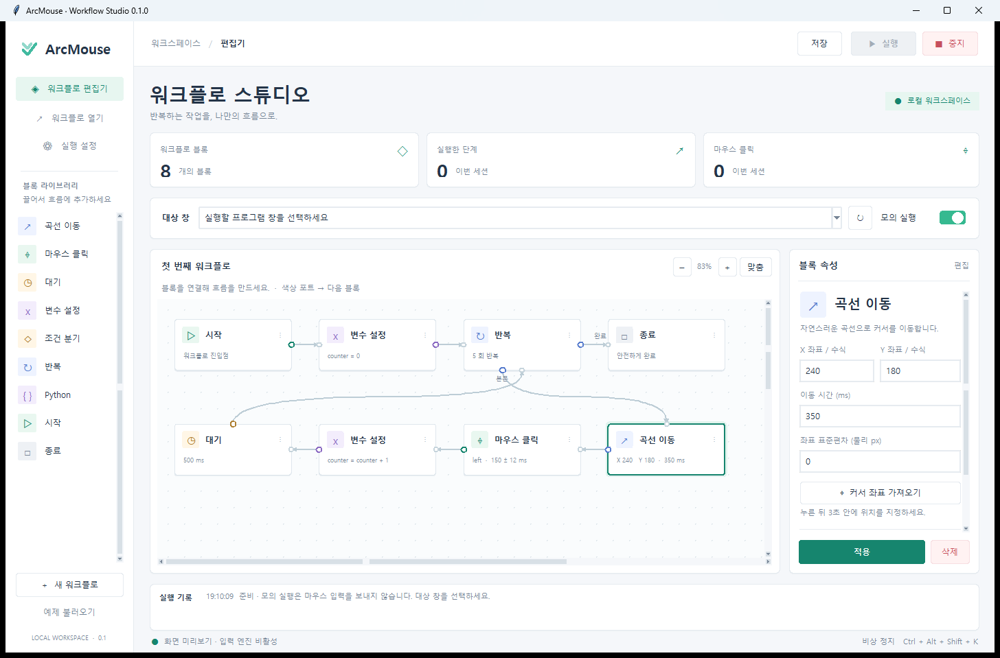

# ArcMouse

**직접 설계하고, 확인하고, 멈출 수 있는 Windows 마우스 자동화.**

화이트·민트 테마의 네이티브 시각적 편집기, 별도 실행 프로세스, 별도 안전 감시 프로세스를 갖춘 소스 배포 프로젝트입니다. 기본 실행은 실제 마우스를 움직이지 않는 **모의 실행**입니다.



입력 엔진을 끈 화면 검증용 실제 앱 캡처입니다. 흰색 카드, 옅은 회색 작업 영역, 민트 포인트와 고정 속성 패널을 사용합니다. 작은 창에서는 상단 요약 카드를 자동으로 접어 편집 공간을 확보합니다.

> **0.1.0 · 초기 개발 버전.** 소스와 자동 테스트가 포함되어 있습니다. USB 하드웨어 실기 검증, 다양한 DPI/다중 모니터 및 장시간 부하 검증은 아직 완료되지 않았습니다. 차단 우회 또는 실시간 응답을 보장하는 제품이 아닙니다.

## 시작하기

Windows 10/11, Python 3.11 이상(Tkinter 포함)이 필요합니다. 소프트웨어 모드는 추가 Python 패키지가 필요 없습니다. `.exe` 빌드나 설치 프로그램은 포함하지 않습니다.

```powershell
git clone https://github.com/Ragim-Games/ArcMouse.git
cd ArcMouse
python main.py
```

아직 저장소에 소스가 게시되지 않은 경우 제공된 소스 ZIP을 먼저 풀고 같은 명령을 실행하세요.

1. 상단 **TARGET**에서 대상 창을 선택합니다. 목록을 갱신하려면 ↻를 누릅니다.
2. 기본 예제의 곡선 이동 블록에서 X/Y를 설정합니다. **3초 후 커서 좌표 가져오기**로 대상 창의 위치를 가져올 수도 있습니다.
3. **모의 실행**을 유지한 채 실행을 누르고 3초 안에 대상 창을 활성화합니다. 포커스가 다른 창에 있으면 실행을 중단합니다.
4. 실행 기록과 흐름을 확인합니다. 실제 입력을 원할 때만 모의 실행을 해제합니다.
5. **Ctrl + Alt + Shift + K**로 즉시 중지를 요청합니다. **F12**도 Raw Input을 통해 보조 비상 정지 키로 처리합니다. UI의 정지 버튼도 사용할 수 있습니다.

예제는 창 내부 `(240, 180)` DIP로 이동하고 왼쪽 클릭을 5회 합니다. 테스트용 빈 창에서 시작하세요. 대상 창 내부의 기능과 데이터에 맞게 좌표를 먼저 바꾸어야 합니다.

## 기능

| 영역 | 구현 |
|---|---|
| 시각적 편집기 | 블록 드래그, 포트 연결, 속성 편집, JSON 저장/불러오기, 실행 위치 표시 |
| 로직 | IF/ELSE, 횟수 반복, 숫자 변수, 제한된 산술·비교·논리 수식 |
| 확장 | 신뢰한 Python 스크립트 + `api.move/click/wait/set_var/get_var/log` |
| 이동 | 3차 Bezier 곡선, smoothstep 가감속, 최대 125회/초를 목표로 한 분할 이동 |
| 변동 | 클릭 전 대기 및 이동 목적지의 가우시안 변동, ±3σ 제한, 항상 5 ms 하한 |
| 좌표 | 대상 창 클라이언트 기준 DIP 또는 0~1 비율; 매 이동 단계에서 창 위치 재계산 |
| 입력 | Windows `SendInput` 또는 USB MCU의 실제 HID 리포트 |
| 안전 | 독립 감시 프로세스, 전역 핫키, Job Object 종료, 물리 입력 후 0.5초 양보 |
| 대상 검증 | HWND + PID + 프로세스 생성 시각, 프로세스 생존, 최소화/포커스, 클릭 위치 가림 검사 |

Python 확장을 먼저 구현했으며 Lua와 JavaScript 런타임은 포함하지 않습니다. 125 Hz는 이동 분할의 설계 상한이며 OS 스케줄링·입력 처리·하드웨어 통신에 따라 실제 처리율은 낮아집니다. 클릭은 간격, 노드 처리, USB 응답 시간을 포함하므로 설정값을 그대로 CPS로 환산할 수 없습니다.

## 편집기

- 왼쪽 블록을 클릭하거나 캔버스에 드래그합니다. 작은 화면에서는 블록 목록을 스크롤합니다.
- 블록 가장자리의 색상 포트에서 다음 블록으로 드래그합니다. 연결 방향에 따라 포트가 위·아래·좌·우에 배치됩니다. 오른쪽 연결 드롭다운으로도 지정할 수 있습니다.
- 반복 블록의 **반복 본문**은 첫 본문 블록에, 본문의 마지막 블록은 다시 반복 블록에 연결합니다. **반복 완료**는 다음 단계에 연결합니다.
- `counter = counter + 1`, `counter < 5`, `counter % 2 == 0` 같은 수식을 사용할 수 있습니다. 변수는 먼저 초기화합니다.
- 캔버스는 휠로 세로 이동, Shift+휠로 가로 이동, 가운데 버튼 드래그로 이동합니다.
- `−` / `＋` 또는 Ctrl+휠로 확대·축소하고, **맞춤**으로 전체 흐름을 볼 수 있습니다. 화면 맞춤 상태에서는 창 크기 변경에 맞춰 배율도 조정합니다.
- 오른쪽 속성 패널은 스크롤할 수 있으며 **적용 / 삭제** 버튼은 하단에 고정됩니다. 설정 창도 스크롤할 수 있습니다.
- `Ctrl+S` 저장, `Ctrl+O` 열기, 캔버스에 포커스가 있을 때 Delete로 블록을 삭제합니다.
- 연결이 미완성인 초안도 저장할 수 있습니다. 실행 시에는 연결과 수식을 검증합니다.

## 안전 동작과 범위

감시 프로세스가 전역 단축키와 Raw Input을 처리합니다. 중지 요청은 먼저 취소 이벤트를 설정하고 최대 80 ms의 정상 종료 대기 후 Job Object를 닫아 실행 프로세스와 그 자식 프로세스를 종료합니다. GUI 응답이 2.5초간 없으면 실행을 종료합니다. 실행은 최대 30분, 엔진은 최대 100,000개 노드 방문으로 제한합니다. 논리만 반복하는 흐름에도 5 ms 대기를 적용합니다.

물리 키보드 입력, 마우스 버튼, 150 ms 안에 누적된 마우스 이동량 3 raw counts 이상을 감지하면 마지막 감지부터 0.5초 대기합니다. Raw counts는 물리 픽셀과 다릅니다. 하드웨어 모드에서는 정확히 선택한 MCU의 HID 장치 경로만 제외합니다. 실제 마우스를 잘못 제외하면 그 장치의 입력 감지가 동작하지 않으므로 연결 전후 장치 목록을 비교해야 합니다.

Windows가 정상적으로 스케줄링하는 환경을 전제로 합니다. 커널 정지·보안 데스크톱·일부 독점 입력 환경까지 소프트웨어 핫키가 작동한다고 보장하지 않습니다. F12는 Windows 디버거 예약 키이므로 기본 전역 등록 키로 사용하지 않습니다. USB에는 별도 물리 정지 버튼과 150 ms watchdog을 제공하지만, 이 구현은 인증된 안전 시스템이 아닙니다.

창 검증과 입력 제출 사이에는 짧은 경쟁 조건이 남습니다. `SendInput`은 특정 HWND에만 전달되는 API가 아니므로 OS 수준의 원자적 대상 고정을 보장하지 않습니다. 대상이 포커스를 잃으면 중지하고, 클릭 바로 전 가림 검사를 수행해 위험을 줄입니다. 더 높은 권한의 앱에는 Windows UIPI로 입력이 거절될 수 있습니다.

## 좌표와 디스플레이

기본은 **대상 창 테두리/제목 표시줄을 제외한 클라이언트 영역**입니다. DIP 모드는 `GetDpiForWindow()/96`으로 배율을 적용합니다. 창 크기에 따라 같은 비율 위치를 원하면 설정에서 비율 좌표로 바꾸고 `0.5, 0.5`처럼 입력합니다. 모드 변경 시 기존 숫자는 자동 변환하지 않습니다.

고정 DIP는 창 크기 변경에 따른 앱 자체 레이아웃 변경까지 추론하지 않습니다. 비율도 반응형 레이아웃, 게임 내부 렌더링 배율, UI 구성 변경에 대한 의미 기반 위치 추적은 아닙니다. 좌표가 창 밖이면 조용히 보정하지 않고 오류로 중단합니다. 곡선의 중간 경로가 창 밖으로 나가도 중단할 수 있으므로 가장자리에서는 이동 시간/목적지를 조정하세요.

## 하드웨어 모드

```powershell
python -m pip install -r requirements-hardware.txt
```

Leonardo/Micro 펌웨어와 Pico CircuitPython 펌웨어를 포함합니다. 실제 USB HID 장치로 열거되며 CDC 시리얼로 PC 명령을 받습니다. 상세 배선·업로드·포트 구분은 [하드웨어 문서](docs/HARDWARE.md)를 참고하세요. MCU가 없으면 Windows 모드로 사용할 수 있습니다.

## Python API

```python
api.set_var('counter', 0)
for i in range(5):
    api.move(240, 180, duration_ms=400, noise_px=1)
    api.click('left', interval_ms=180, jitter_ms=15)
    api.set_var('counter', i + 1)
    api.wait(300)
api.log(f"완료: {api.get_var('counter')}")
```

스크립트는 기본적으로 꺼져 있고, 새 파일을 열면 허용 설정이 초기화됩니다. 설정에서 신뢰한 Python 실행을 켜야 합니다. **별도 프로세스는 보안 샌드박스가 아닙니다.** Python은 사용자 권한으로 파일·네트워크·프로세스에 접근할 수 있습니다. 모의 실행은 `api`의 마우스 출력만 생략하며 임의 Python 코드의 부작용은 막지 않습니다. 알 수 없는 워크플로의 스크립트는 실행하지 마세요. 로그는 초당 최대 10개로 제한됩니다.

## 개발 및 검증

```powershell
python -m unittest discover -s tests -v
python -m compileall -q arcmouse main.py firmware/pico
```

테스트는 실제 마우스 입력을 보내지 않습니다. Windows에서는 Win32 구조체 크기와 Job Object의 프로세스 강제 종료를 추가 확인합니다. GitHub Actions는 Windows/Linux, Python 3.11/3.14에서 같은 검사를 실행하도록 구성되어 있습니다. [검증 결과와 수동 점검표](docs/VALIDATION.md), [아키텍처](docs/ARCHITECTURE.md)를 참고하세요.

## 공개 배포

저장소: [Ragim-Games/ArcMouse](https://github.com/Ragim-Games/ArcMouse)

이 프로젝트는 소스만 배포합니다. 저장소 루트에 본 폴더의 내용(`main.py`, `arcmouse`, `firmware`, `tests`, `.github` 등)을 넣으면 됩니다. 기존 저장소 내용은 먼저 확인하고 일반 커밋/푸시를 사용하세요. `.exe`, 개인 워크플로, 로그, 인증 정보는 포함하지 않습니다.

MIT License. [LICENSE](LICENSE)

## 구현 참고 문서

- [Microsoft: RegisterHotKey](https://learn.microsoft.com/en-us/windows/win32/api/winuser/nf-winuser-registerhotkey)
- [Microsoft: SendInput](https://learn.microsoft.com/en-us/windows/win32/api/winuser/nf-winuser-sendinput)
- [Microsoft: Raw Input](https://learn.microsoft.com/en-us/windows/win32/inputdev/raw-input)
- [Microsoft: DPI awareness](https://learn.microsoft.com/en-us/windows/win32/hidpi/setting-the-default-dpi-awareness-for-a-process)
- [Arduino: USB Mouse](https://docs.arduino.cc/language-reference/en/functions/usb/Mouse/)
