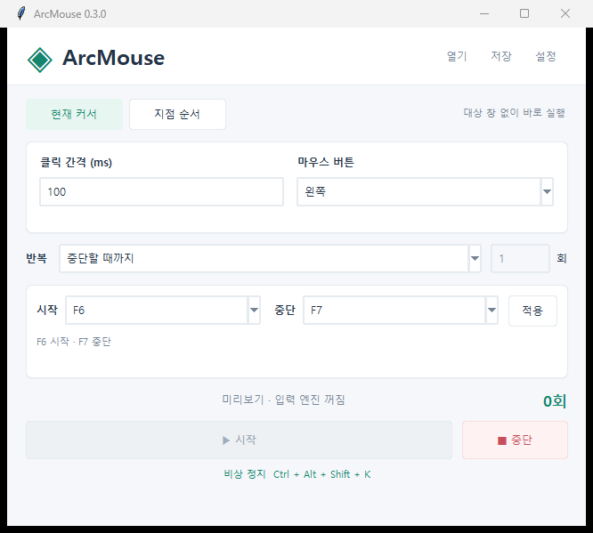
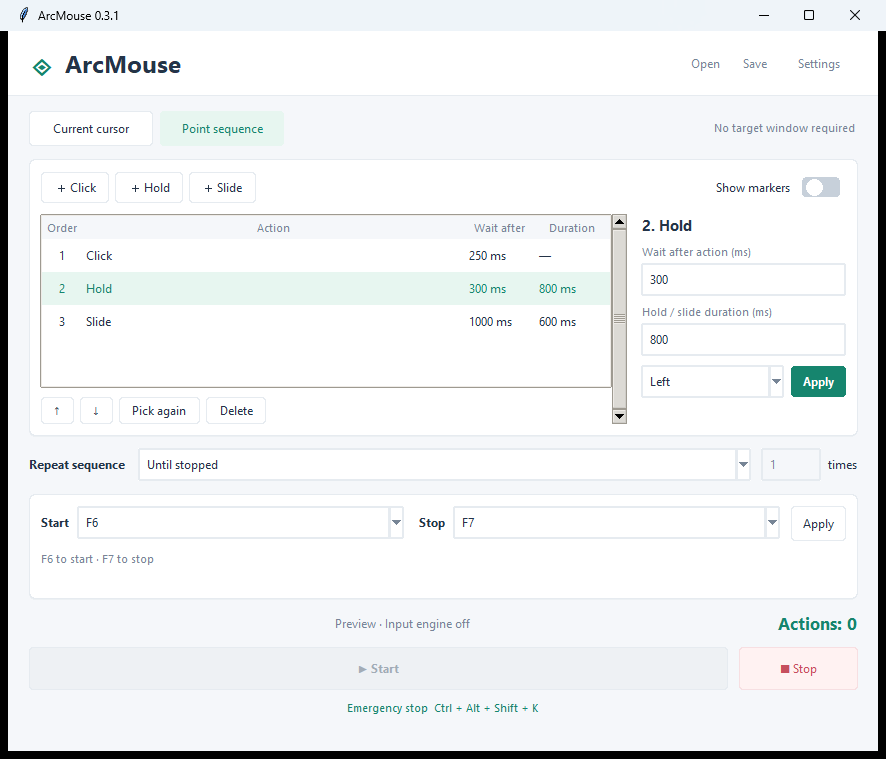

# ArcMouse

**A Windows auto-clicker for repeated clicks at the current cursor or a sequence of points picked on screen.**



## Windows download

Download the EXE or portable ZIP from [GitHub Releases](https://github.com/Ragim-Games/ArcMouse/releases/latest). The Windows x64 build includes Python, Tkinter, and optional USB serial support, so no Python installation is required. Run the downloaded EXE, or extract the ZIP and open `ArcMouse.exe`.

The executable is unsigned; Windows may display an unknown-publisher warning. Source code remains available below.

## Run from source

Requires Windows 10/11 and Python 3.11 or later with Tkinter. The default Windows input mode needs no additional packages. The optional EXE build is available separately from the source.

```powershell
git clone https://github.com/Ragim-Games/ArcMouse.git
cd ArcMouse
python main.py
```

To update an existing checkout, run `git pull`, then `python main.py`.

## Current cursor: set an interval, start, stop

1. Select **Current cursor** and set the click interval, mouse button, and repeat count.
2. Place the cursor where you want to click and press **F6**.
3. Press **F7** to stop. To change either hotkey, edit it in the app and select **Apply**.

No target window or coordinate entry is required. Defaults are a 100 ms interval, the left mouse button, and repetition until stopped. ArcMouse minimizes when execution starts and returns when it finishes or stops. Moving the physical mouse does not automatically pause execution; use your Stop hotkey.

Combine letter keys with Ctrl or Alt, for example `Ctrl+Alt+S`. Start and Stop must use different hotkeys. If registration fails, the app explains the error and keeps the previous bindings. F12 is excluded. **Ctrl+Alt+Shift+K** is a separate emergency stop shortcut; if it cannot be registered, the footer tells you to use your configured Stop hotkey instead.

## Point sequence: pick points, then run



1. Open **Point sequence**.
2. Select **+ Click** or **+ Hold**, then click a location on the screen. For **+ Slide**, drag from the start point to the end point. Press Esc to cancel selection.
3. Select a point in the list, set **Wait after action (ms)**, and select **Apply**. Holds and slides also have a separate **Hold / slide duration (ms)** setting.
4. Use the up/down arrows to reorder points, or select **Delete**. Enable **Show markers** to drag the numbered markers into position. For slides, A is the start and B is the end.
5. Set how many times to repeat the entire sequence, then press your Start hotkey.

Example: `Click point 1 → wait 250 ms → hold point 2 for 800 ms → wait 300 ms → slide from 3A to 3B over 600 ms → wait 1000 ms`, then begin the next cycle. The final action's wait also applies. A slide is a drag with the selected mouse button held down.

Markers are hidden and the app minimizes before execution. A sequence supports up to 200 points. Points use screen pixel coordinates, so check them again after moving application windows or changing monitor layout or display scaling. Execution is rejected if a saved point is outside the current virtual desktop.

Use **Save / Open** to store points, order, timing, repetition, and hotkeys in a JSON profile. Profile format version 3 is used; older workflow files are not supported. Existing 0.3 profiles remain compatible with the English interface.

## Execution and stopping

- The UI, global hotkey monitor, and input engine run in separate processes.
- A 0 ms wait is clamped to a minimum of 5 ms. Hold and slide durations range from 5 to 60,000 ms.
- Stopping releases any button held by a hold or slide. An unresponsive worker is terminated through a Windows Job Object.
- Execution stops if the UI stops responding or a session reaches 30 minutes.
- **Settings → Dry run (no mouse input)** runs without sending mouse input.

Software input is subject to Windows permission restrictions. Elevated apps or programs with specialized input handling may reject it. Millisecond values are requested timings; OS scheduling and USB round trips can increase actual durations.

## USB board support (optional)

Select **Settings → USB board** and enter its COM port. A board is not needed for Windows input mode. See the [hardware guide](docs/HARDWARE.md) for Leonardo/Micro and Pico firmware sources and the **ARCMOUSE/2** protocol. Older firmware must be updated. Physical board validation has not yet been performed.

## Development and validation

```powershell
python -m compileall -q arcmouse main.py firmware/pico
python -m unittest discover -s tests -v
```

Native input validation is a separate, opt-in command. It uses a dedicated blank test window to check finite clicks, holds, slides, global hotkeys, point selection, and marker dragging. Do not use the mouse or keyboard during this test.

```powershell
python tests/manual_native.py --run
```

The screenshots show the real Tk interface with its input engine disabled for preview, so the Start button is intentionally disabled.

[Build the Windows EXE](docs/BUILDING.md) · [Validation results and limitations](docs/VALIDATION.md) · [Architecture](docs/ARCHITECTURE.md) · [MIT License](LICENSE)
