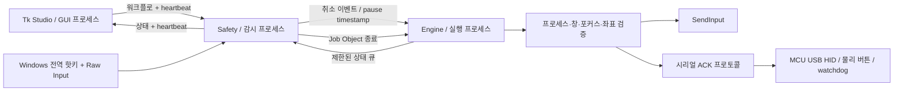

# 아키텍처

## 프로세스 경계

`main.py`가 `spawn` 방식으로 감시 프로세스를 시작합니다. 감시 프로세스는 숨겨진 메시지 전용 HWND에 Raw Input과 핫키를 등록합니다. 등록 실패 시 앱은 실행을 허용하지 않습니다.

워크플로 시작은 3초 카운트다운 후 수행합니다. 실행 프로세스는 gate 이벤트에서 대기하고, 감시 프로세스가 Job Object 할당에 성공해야 실행을 시작합니다. Job Object의 KILL_ON_JOB_CLOSE 정책은 감시 프로세스가 비정상 종료하는 경우에도 worker와 그 자식을 정리하도록 설정됩니다.

감시 루프는 메시지 펌프, bounded IPC drain, UI heartbeat, 실행 한도를 처리합니다. 3 ms sleep으로 바쁜 대기를 피합니다. 입력을 수행하는 스레드는 GUI와 공유되지 않습니다. Python GIL이 GUI 이벤트 처리와 마우스 엔진을 함께 막지 않도록 **스레드보다 강한 프로세스 분리**를 사용했습니다.

## 실행 엔진

`model.py`가 JSON 스키마, 연결, 수식을 검사합니다. 수식은 AST를 직접 해석하며 함수 호출, 속성 접근, 인덱싱, 거듭제곱은 허용하지 않습니다. 변수와 연산 결과는 유한한 숫자로 제한합니다. `if`는 true/false 연결을, `repeat`는 body/done 연결을 선택합니다. 반복 카운터는 해당 반복 블록으로 처음 진입할 때 계산하고 완료 시 삭제합니다.

노드 사이에 최소 5 ms, 클릭 전에도 최소 5 ms 대기를 넣습니다. 대기는 Event.wait와 monotonic clock으로 구현하고 10 ms 이하 단위로 취소·대상 상태를 확인합니다. Bezier 이동도 각 단계마다 취소·대상·좌표를 확인합니다. 설정값은 실시간 실행 보장이 아닌 최소 대기 요청입니다.

API의 `log`는 초당 최대 10개, progress는 초당 약 10회, 이벤트 큐는 128개로 제한합니다. GUI 로그도 길이를 제한하며 캔버스 배경 격자는 매번 다시 만들지 않습니다. 무제한 로그/메모리 증가로 감시 루프를 밀어내지 않도록 한 설계입니다. 신뢰한 스크립트가 API 내부 객체에 직접 접근하는 경우는 보안 경계로 통제하지 않습니다.

## 대상과 좌표

선택할 때 PID/HWND/프로세스 생성 시각을 저장합니다. 실행 시 프로세스 handle을 유지하고, 매 checkpoint에서 프로세스 종료 및 창 상태를 확인합니다. 프로세스 PID가 재사용되면 생성 시각 불일치로 거절합니다.

`GetClientRect`, `ClientToScreen`, `GetDpiForWindow`를 사용합니다. GUI와 두 백그라운드 프로세스 모두 HWND 생성 전 Per-Monitor V2를 요청합니다. 매 이동 단계에서 현재 창 원점을 다시 읽어 이전 화면 좌표를 재사용하지 않습니다. SendInput의 절대 좌표는 음수 원점을 포함하는 가상 데스크톱 전체에 정규화합니다.

`WindowFromPoint`와 `GetAncestor`로 클릭 위치가 다른 창에 가려졌는지 검사합니다. 검사 직후 다른 프로세스가 포커스를 바꾸는 TOCTOU 가능성은 Windows 전역 입력 API의 한계로 남습니다. 특정 창으로 강제 포커스를 이동하거나 다른 앱 위에 강제로 클릭하지 않습니다.

## 신뢰 모델

- 일반 수식은 제한된 AST 평가기로 실행합니다.
- Python 블록은 사용자가 허용한 **신뢰한 코드**입니다. 보안 샌드박스가 아닙니다.
- 소프트웨어 입력은 사용자 권한 범위와 Windows UIPI를 따릅니다.
- HID 모드는 실제 외부 MCU를 필요로 합니다. 탐지 불가능성이나 게임 차단 우회를 보장하지 않습니다.
- 현재 버전에는 텔레메트리, 서버, 로그인, 자동 업데이트가 없습니다.

## 모듈

| 파일 | 책임 |
|---|---|
| `ui.py` | 편집기, 설정, 저장, 사용자 상태 표시 |
| `model.py` | 워크플로 검증, 안전한 수식, 변동/곡선 수학 |
| `engine.py` | 상태 머신, API, 취소 가능한 실행 |
| `supervisor.py` | 감시/종료/heartbeat/worker 생명주기 |
| `win32.py` | ctypes ABI, 대상 검사, Raw Input, SendInput, Job Object |
| `hardware.py` | CDC 시리얼, ACK, 상대 HID 좌표 보정 |
| `firmware/` | MCU 명령 수신과 HID 출력 |
