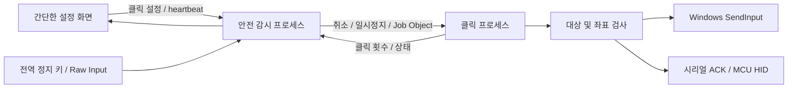

# 구조

ArcMouse 0.2는 하나의 클릭 설정을 반복 실행합니다. 그래프/노드/스크립트 실행 계층은 없습니다.

## 시작

UI는 클릭 간격, 버튼, 횟수, 선택적인 위치와 장치 설정을 전송합니다. `model.validate_settings`가 유한한 숫자, 버튼 이름, 좌표 범위, 반복 횟수를 검사하고 5 ms 하한을 적용합니다. 횟수 0은 중지할 때까지 반복한다는 의미입니다.

감시 프로세스는 3초 카운트다운 후 대상을 확정합니다. 자동 선택이면 그 순간의 foreground HWND와 PID/프로세스 생성 시각을 저장하며 바탕화면·작업 표시줄·ArcMouse 자체는 거절합니다. 명시적으로 선택한 창은 저장된 프로세스 생성 시각으로 재사용된 PID를 구분합니다. 이후 다른 프로그램으로 대상을 바꾸지 않습니다.

클릭 프로세스는 gate 이벤트에서 대기하며, Job Object 할당이 성공해야 실행합니다. 기본 동작은 간격 대기 → 대상 확인 → 현재 커서 위치 검사 → 클릭입니다. 위치 지정을 켜면 간격 대기 후 창 내부 좌표를 다시 계산하고 곡선 이동을 한 뒤 클릭합니다.

## 중단

감시 프로세스는 `Ctrl+Alt+Shift+K`와 Raw Input의 F12를 처리합니다. 취소 이벤트 설정 후 80 ms 동안 정상 종료를 기다리고, 필요하면 Job Object를 닫아 프로세스와 자식 프로세스를 종료합니다. GUI heartbeat가 2.5초 없으면 종료합니다. 실행 엔진과 독립된 감시 루프에 30분 한도가 있습니다.

마우스 버튼·키보드 또는 150 ms 안에 누적 3 raw counts 이상의 물리 마우스 움직임은 0.5초 대기를 유발합니다. Raw counts는 화면 픽셀과 다릅니다. MCU 모드는 사용자가 정확히 선택한 장치 경로만 제외합니다.

`Event.wait`와 monotonic clock으로 기다리며 대기 중에도 10 ms 이하 단위로 취소·대상 상태를 확인합니다. GUI와 실행 프로세스는 Python GIL을 공유하지 않습니다. 진행 상태는 약 10 Hz, 큐는 128개로 제한합니다.

## 좌표 및 한계

Per-Monitor V2를 요청하고 클라이언트 원점·창 DPI·창 크기를 읽습니다. DIP 또는 0~1 비율을 사용할 수 있습니다. 창 밖 좌표는 오류로 중지합니다. 클릭 위치가 다른 창에 가려졌는지도 검사합니다. 앱 내부 레이아웃 변경이나 게임의 렌더링 배율을 추론하지는 않습니다.

SendInput은 특정 HWND에 원자적으로 묶인 API가 아니므로 검사 직후 포커스가 바뀌는 경쟁 조건은 남습니다. USB 입력에도 통신 및 OS 처리 시간이 필요합니다. 실제 장치·DPI 조합·장시간 부하 검증은 별도로 필요합니다.

## 파일

| 파일 | 역할 |
|---|---|
| ui.py | 한 화면 설정, 시작/중지, 클릭 횟수 |
| design.py | 밝은 테마의 패널·버튼·토글 |
| model.py | 단일 클릭 설정 검증, 곡선·변동 계산 |
| engine.py | 취소 가능한 클릭 반복 |
| supervisor.py | 전역 정지, 대상 확정, 프로세스 감시 |
| win32.py | Win32 입력, 물리 입력 감지, 창 검사 |
| hardware.py / firmware | 선택적인 USB HID 입력 |
